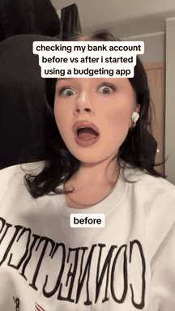
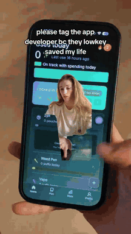
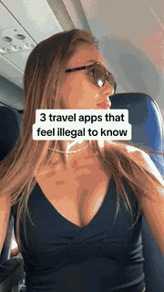
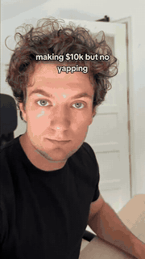
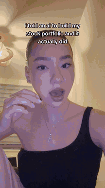
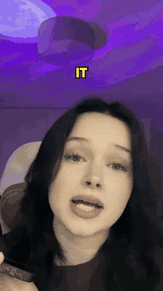
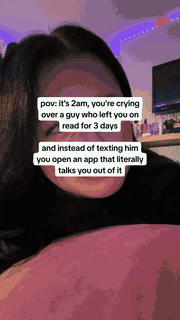

# reelclaw-templates

**Viral short-form video templates you make and edit with Claude Code or Codex.** Pick a format that already works on TikTok, Reels and Shorts, install it with one line, hand the agent your clips, and get a 1080×1920 MP4 you can post.

```bash
npx reelclaw@latest add reaction-demo
```

Then open `claude` or `codex` in that folder and say *"make a reaction-demo reel with react.mp4 and demo.mov, hook: i was about to quit and this app talked me out of it"*.

- **One line per template.** No clone and no boilerplate. New templates ship from this repo without an npm release.
- **Agent-native.** Every template is also an [Agent Skill](https://agentskills.io): inputs to collect, the exact command and a playbook for the format. Claude Code and Codex both read it.
- **Your footage.** Local files, links (TikTok, Instagram, YouTube, X) or direct URLs. Optionally, real-creator clips from [DanSUGC](#footage-with-or-without-dansugc).
- **Editable output.** Each reel is a plain [HyperFrames](https://hyperframes.heygen.com) HTML composition with semantic ids. Ask the agent to move a caption, change a cut or retime a word, then re-render.
- **Platform-safe by default.** TikTok Sans, captions auto-fitted inside the cross-platform safe zone, static text, muted clip audio unless the format needs it ([RULES.md](RULES.md)).

## See it in action

| [`reaction-demo`](templates/reaction-demo/): one prompt, one reel | [`no-yapping`](templates/no-yapping/): example reel | [`greenscreen-reaction`](templates/greenscreen-reaction/): example reel |
| :---: | :---: | :---: |
| [](examples/reaction_demo.mp4) | [](examples/no_yapping.mp4) | [](examples/greenscreen_reaction.mp4) |

## Install

| You want | Run |
| --- | --- |
| One template in the current folder | `npx reelclaw@latest add reaction-demo` |
| A fresh folder, straight into the agent | `npx reelclaw@latest add reaction-demo --dir my-reels && cd my-reels && claude` (or `codex`) |
| Pick from the catalog | `npx reelclaw@latest add` |
| Every template | `npx reelclaw@latest add --all` |
| Only the skill (any agent; it installs the engine the first time it runs) | `npx skills add danielhangan/reelclaw-templates --skill reaction-demo` |
| All template skills as a Claude Code plugin | `claude plugin marketplace add danielhangan/reelclaw-templates && claude plugin install reelclaw-templates@reelclaw-templates` |
| Straight from GitHub (no npm release needed) | `npx github:danielhangan/reelclaw-templates add reaction-demo` |

`add` sets up a reel project: `templates/<id>/`, the `reelclaw` engine (`npm install`), and instructions for both agents (`CLAUDE.md` and `.claude/skills/` for Claude Code, `AGENTS.md` and `.agents/skills/` for Codex). It finishes with `reelclaw doctor`. Run it again later to add more templates. It updates the ones you have not edited and keeps the ones you have. Details: [docs/INSTALL.md](docs/INSTALL.md).

**Requirements:** Node.js 22+ and ffmpeg (`brew install ffmpeg` · `sudo apt install ffmpeg` · `winget install ffmpeg`). yt-dlp is optional and only needed for page links. HyperFrames downloads headless Chrome on the first render.

## Templates

<!-- gallery:start (generated by `npm run registry` from registry.json — do not edit by hand) -->
| Preview | Template | What it makes | Install |
| :---: | --- | --- | --- |
|  | **[Before / After](templates/before-after/)**<br>`before-after` · before-after | Before/after transformation reveal from two photos or clips: a full-screen swipe from before to after, or a labelled top/bottom split. For glow-ups, makeovers, results, edits and app redesigns.<br><sub>media: `--before`, `--after`, `--music`</sub> | `npx reelclaw@latest add before-after` |
|  | **[Greenscreen reaction](templates/greenscreen-reaction/)**<br>`greenscreen-reaction` · greenscreen | TikTok greenscreen reaction: any video plays full screen while a creator, cut out of their background by a local AI model, talks over it from a corner. Both soundtracks on; optional drag-into-place opener.<br><sub>media: `--video`, `--reaction`</sub> | `npx reelclaw@latest add greenscreen-reaction` |
|  | **[Numbered Listicle](templates/listicle/)**<br>`listicle` · listicle | "3 apps that feel illegal to know" countdown: a hook title card, then numbered items — each with its own clip or photo, title and optional note — and an optional CTA. Optional beat-synced cuts.<br><sub>media: `--item`, `--hook-clip`, `--music`</sub> | `npx reelclaw@latest add listicle` |
|  | **[…but no yapping](templates/no-yapping/)**<br>`no-yapping` · tutorial | Silent split-screen tutorial: a fullscreen intro under an outcome hook ("making $10k but no yapping"), then typing footage over a screen recording with short step captions on the seam. Farms saves and shares.<br><sub>media: `--intro`, `--typing`, `--demo`, `--music`</sub> | `npx reelclaw@latest add no-yapping` |
|  | **[Reaction → Demo](templates/reaction-demo/)**<br>`reaction-demo` · reaction | UGC reaction hook into an app demo: a creator reacts for ~3s under a hook caption, then a hard cut to the screen recording that answers it.<br><sub>media: `--reaction`, `--demo`, `--music`</sub> | `npx reelclaw@latest add reaction-demo` |
|  | **[Talking head + word captions](templates/talking-head-captions/)**<br>`talking-head-captions` · talking-head | Creator talking to camera with bold word-by-word captions (spoken word highlighted), tightened pauses, punch-in zooms, optional hook title, b-roll cutaways and ducked music. The default edit for advice, storytime and UGC testimonials.<br><sub>media: `--clip`, `--broll`, `--music`</sub> | `npx reelclaw@latest add talking-head-captions` |
|  | **[Wall of Text over B-roll](templates/wall-of-text/)**<br>`wall-of-text` · text-story | POV / storytime / confession: a long first-person text in TikTok's native white text box over looping b-roll, with an optional second card (the reveal). The go-to organic app-promo format.<br><sub>media: `--broll`, `--music`</sub> | `npx reelclaw@latest add wall-of-text` |
<!-- gallery:end -->

Each template folder has a README with every flag, and a SKILL.md with the playbook. [`catalog/`](catalog/) holds the roadmap: about 200 researched viral formats, their taxonomy, and the engine features each one needs.

## Make a reel by hand

The agent runs these for you, but they are plain commands:

```bash
npx reelclaw make reaction-demo --reaction react.mp4 --demo demo.mov \
  --hook "i was about to quit and this app talked me out of it" --draft   # → renders/reaction-demo-1.mp4
npx reelclaw make reaction-demo --props reels/reaction-demo-1.json --hook "new hook" --name b --draft
npx reelclaw batch reaction-demo hooks.json --props reels/reaction-demo-1.json   # one reel per row
npx reelclaw render b                                                      # final quality
npx reelclaw make reaction-demo --help                                     # every flag
```

`reels/<name>.html` is the composition and `reels/<name>.json` holds the inputs that made it. After hand edits, run `npx reelclaw check <name>`, then `npx reelclaw render <name>`.

## How it works

```
templates/<id>/template.mjs        defineTemplate({ inputs, build })   ← 40–150 lines per template
        │  inputs: flags or --props JSON, validated (zod); media copied to assets/ and probed
        ▼
build({ inputs }) → timeline([...])  video · visual · caption · music · html … + components
        │                            (blur fill, native text, word captions, cut-outs, beat sync, wipes)
        ▼
compile → reels/<name>.html          one deterministic HyperFrames composition, one paused GSAP timeline
        ▼
hyperframes@0.8.181 render → renders/<name>.mp4   (pinned renderer: a reel re-renders identically)
```

A template declares its inputs once. They drive the CLI flags, validation, the props schema, the README flags table, the registry entry and the agent skill. `build()` is pure: it says what is on screen and when, and the engine handles downloads, probing, safe zones, caption fitting, linting and rendering. Start with [`templates/reaction-demo/template.mjs`](templates/reaction-demo/template.mjs) (about 60 lines), then [docs/TEMPLATE_API.md](docs/TEMPLATE_API.md) and [docs/ARCHITECTURE.md](docs/ARCHITECTURE.md).

## Contribute a template from a link

Seen a format going viral? Turn it into a template:

```bash
gh repo fork danielhangan/reelclaw-templates --clone && cd reelclaw-templates
npm install && npm run fixtures
claude   # or codex
> make a template from https://www.tiktok.com/@creator/video/...
```

The repo's `new-template` skill runs `reelclaw analyze` on the video (shots, cut times, pacing, keyframes), describes the format and checks it with you. It then scaffolds `templates/<id>/`, renders it next to the reference to compare, validates, and opens a PR. Only the link is stored, never the video. The manual steps and the review criteria are in [CONTRIBUTING.md](CONTRIBUTING.md). No time to build it? [Request a template](https://github.com/danielhangan/reelclaw-templates/issues/new?template=template-request.yml).

## Footage: with or without DanSUGC

Templates run on **your own clips**. A 3-second phone selfie makes a fine reaction hook.

If you want real-creator UGC (reaction hooks, typing shots, intros), **[DanSUGC](https://dansugc.com)** sells clips ready to drop into these templates. Connect its MCP server and the agent can search for clips that match your hook, show prices in credits, and buy only after you say yes:

```bash
claude mcp add --transport http dansugc https://dansugc.com/mcp    # Claude Code
codex mcp add dansugc --url https://dansugc.com/mcp                # Codex
```

This is optional. Every template works without it.

## Repo layout

```
packages/reelclaw/    the `reelclaw` npm package: engine (src/core), CLI (src/cli), analyze/scaffold (src/analyze)
templates/<id>/       template.mjs · SKILL.md · README.md · example.json · preview.gif
registry.json         generated catalog that `reelclaw add` reads from GitHub (npm run registry)
.claude-plugin/       generated marketplace manifest (Claude Code plugin + `npx skills`)
.claude/ .agents/     the new-template skill for contributors (Claude Code / Codex)
catalog/              format research: taxonomy, ~200 formats, primitives roadmap
shared/fonts/         TikTok Sans (single canonical copy, OFL)
cli/                  legacy `reelclaw-templates` package: forwards to `reelclaw add`
scripts/ test/ .github/   fixtures, registry, smoke renders, integration tests, CI
```

Development: `npm install && npm run fixtures`, then `npm run check` (typecheck, unit tests, validate every template). `npm run test:integration` makes every example and checks it is deterministic.

## Licenses

- Code: MIT.
- TikTok Sans is redistributed under the [SIL Open Font License 1.1](shared/fonts/OFL.txt).
- You are responsible for the rights to the footage and music you put into a reel, and for each platform's terms.
